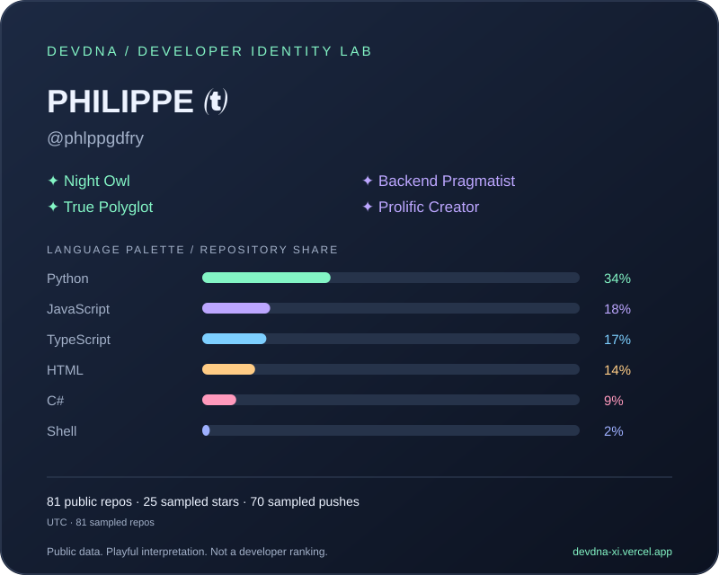

# Complete product catalogue

[Organisation home](https://github.com/phlppgdfry-apps) · [About Philippe](https://philippegodfroy.com)

This catalogue includes published products, active development projects and earlier native-app experiments. Store listings and public releases are linked where verified. A development project is not presented as an available download.

## Available iPhone and iPad apps

### Hand Mirror (ReflectBuddy)

A pocket mirror with light, zoom and freeze-frame controls.

**Store name:** Hand Mirror: HD, Light & Zoom 
**Published version checked:** 2.0.3 
**Minimum OS listed by Apple:** 16.6

[Open the App Store listing →](https://apps.apple.com/app/id6738931920)

### RingSizer

Measure a ring or finger and convert between international ring sizes.

**Store name:** RingSizer – Ring Size Tool 
**Published version checked:** 1.0 
**Minimum OS listed by Apple:** 17.0

[Open the App Store listing →](https://apps.apple.com/app/id6798043494)

## Available Mac apps

### MirrorMate

A menu-bar mirror for quick camera checks before a call or meeting. Publicly listed as **Mirror Mate - Menubar Mirror**, version **1.2**, requiring macOS **14.6** or later according to the store listing checked.

[Mac App Store →](https://apps.apple.com/app/id6752225278) · [Website](https://mirrormateapp.com) · [Public showcase](https://github.com/phlppgdfry/MirrorMate-App)

The public showcase repository contains product materials; the application source is private.

### ClickTrack

Native Mac activity analytics for clicks, keystrokes, scrolling, focus sessions and trends. The product documentation explains local storage and the required macOS Accessibility permission.

[Latest public download →](https://github.com/phlppgdfry/ClickTrack/releases/latest) · [Website](https://clicktrackapp.com) · [Source and installation](https://github.com/phlppgdfry/ClickTrack)

Follow the current release instructions for compatibility, signing and activation details.

## Native apps in development

### LEASH

**iOS · In development**

A dog-walking coach for calmer walks and structured practice.

### Fyesto

**iOS · Demo app in development**

Social event discovery, shared plans and experiences with friends.

### TodayIs

**iOS · MVP in development**

Discover daily celebrations, observances and notable days, with Belgian and Dutch context.

### Barkless

**iOS · Concept beta**

A home barking-coach app with guided practice and manual progress tracking; training content remains under development.

### ReflectBuddy for Android

**Android · In development**

An Android mirror app with light, zoom and capture controls.

Fyesto currently runs in demo mode; its real backend is not connected. Barkless is a concept beta with training content still in development. These entries describe the projects, not a release timetable or an invitation to a public beta.

## Web and business products

### DevDNA

**Web + CLI · Public demo**

Explore public GitHub profiles, compare language and activity patterns, and export a shareable card. Traits are playful interpretations of sampled public signals, not measures of developer ability.

[Open the app →](https://devdna-xi.vercel.app) · [Example profile](https://devdna-xi.vercel.app/phlppgdfry) · [Compare](https://devdna-xi.vercel.app/compare) · [Source & CLI](https://github.com/phlppgdfry/devdna)

### CABINE

**Web · Frontend prototype**

A Belgium-first beach cabin discovery and rental-network concept.

### StaySignal

**Web · Product prototype**

An evidence-led workspace for Airbnb listing intelligence.

### Auditly

**Web · Product prototype**

An Airbnb listing audit with a score, actionable improvement plan and guest-impact explanations.

### YardExx

**Web · Product prototype**

A logistics capacity exchange concept for yards, storage and related capacity.

### VoltYard

**Business software · In development**

EV battery, charging and operational-record workflows for vehicle terminals.

## Prototypes and experiments

Earlier projects found in the native-app workspace. No public distribution was verified for these entries.

- **StampMate · iOS · Local prototype:** A camera project with timestamp and location-stamp features.
- **Flashlight Pro · iOS · Local prototype:** A flashlight utility project with light controls and a timer.
- **Forrest · iOS · Local prototype:** A wellbeing and habit-recovery tracker concept with journaling and progress views.
- **SmartCard Model · iOS · Local prototype:** A model profile and portfolio-card project.
- **Fireworks · iOS · Local experiment:** An exploratory fireworks information and incident-reporting project.

## Reviewell — separate commercial service

[Reviewell](https://github.com/reviewell-app) focuses on Google review removal for businesses, with broader content-removal and reputation services. [Start a free review check →](https://www.reviewell.com/#check)

## Verification and maintenance

Checked on **22 October 2026** against the public Apple catalogue, public product repositories and local product records. The Belgian Apple storefront returned Hand Mirror, RingSizer and MirrorMate. Store availability can differ by country.

Development entries are based on product documents and existing source projects. Private repository URLs, implementation notes, account details and credentials are not part of this public catalogue. Prototype entries deliberately do not claim store availability.

The [machine-readable inventory](catalog.json) records all entries. The [repository map](REPOSITORIES.md) distinguishes public source, showcase materials and private app code. For support, follow the product's website or [support guidance](../SUPPORT.md).
